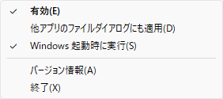

# ExpClassicMenu

Windows 11 の Explorer で右クリックしたとき、Windows 11 形式の新しいメニューではなく、従来(Windows 10 形式)のコンテキストメニューを表示させる常駐アプリです。

Explorer 上の右クリックを Shift+右クリックとして扱わせることで、従来メニューを表示させます。

現在のバージョン:ver002

## 動作環境

- Windows 11(64bit)

## 使い方

1. [Releases](https://github.com/mikekoma/ExpClassicMenu/releases/latest) から `ExpClassicMenu-verXXX.zip` をダウンロードして、好きなフォルダに展開します。インストールは不要です。
2. `ExpClassicMenu.exe` を起動します。タスクトレイにアイコンが表示されます。
3. Explorer のファイル一覧、ナビゲーションペイン、デスクトップで右クリックすると、従来のメニューが表示されます。キーボードのアプリケーションキー(メニューキー)を押したときも同様です。

exe には署名がないため、初めて起動するときに SmartScreen の警告が出ることがあります。その場合は「詳細情報」→「実行」で起動できます。

二重起動はできません。

### タスクトレイのアイコン

| 有効 | 無効 |
|:---:|:---:|
|  |  |

無効のときは、アイコンが灰色になります。

### タスクトレイのメニュー

アイコンを右クリックすると、次のメニューが表示されます。



| 項目 | 内容 |
|---|---|
| 有効 | 機能のオン/オフを切り替えます。アイコンのダブルクリックでも切り替わります |
| 他アプリのファイルダイアログにも適用 | 他のアプリの「開く」「保存」ダイアログでも従来メニューを表示します(初期値はオフ) |
| Windows 起動時に実行 | ログオン時に自動で起動するよう登録、または解除します |
| バージョン情報 | バージョン、著作権、連絡先を表示します |
| 終了 | アプリを終了します |

## 対象となる場所

- Explorer のファイル一覧(`SHELLDLL_DefView`)
- Explorer のナビゲーションペイン(`NamespaceTreeControl`)
- デスクトップ
- 他アプリのファイルダイアログ(設定でオンにした場合)

タスクバーと通知領域は対象外です。

## 仕組み

- 低レベルマウスフック(`WH_MOUSE_LL`)で右ボタンの操作を監視します。
- 対象となる場所で右ボタンが押されたら、その直後に Shift キーの押下を `SendInput` で送ります。
- 右ボタンを離してから 200ms 後に Shift キーを離します。
- 右ボタンの操作そのものは横取りしないので、右ドラッグ(コピー/移動メニュー)もいつもどおり使えます。
- 自分で Shift キーを押しているときは何もしません。
- 低レベルキーボードフック(`WH_KEYBOARD_LL`)でアプリケーションキーも監視します。フォーカスのある場所が対象なら、最初の押下を止めて「Shift 押下 → アプリケーションキー押下」の順に `SendInput` で送り直します。キーを離してから 200ms 後に Shift キーを離します。

## 設定の保存先

| 内容 | 保存先 |
|---|---|
| 有効/無効、ファイルダイアログへの適用 | `HKEY_CURRENT_USER\Software\ExpClassicMenu` |
| Windows 起動時に実行 | `HKEY_CURRENT_USER\Software\Microsoft\Windows\CurrentVersion\Run` の値 `ExpClassicMenu` |

アンインストールするときは、「Windows 起動時に実行」のチェックを外してから終了し、exe を削除してください。上記のレジストリキーも不要なら削除してください。

## 注意事項

- 管理者権限で動いているウィンドウ上では動作しません(Windows の UIPI による制限)。
- 右クリック中(アプリケーションキーを押している間)、ほかのアプリからは Shift キーが押されているように見えます。

## ビルド

Delphi(RAD Studio)でビルドします。VCL は使わず、WinAPI だけで作っています。

- IDE の場合: `ExpClassicMenu.dproj` を開いてビルドします。
- コマンドラインの場合:

```
dcc64 -B "-NSWinapi;System;System.Win" -EWin64\Release -NUWin64\Release\dcu ExpClassicMenu.dpr
```

### 配布用 zip の作成

`make-release.ps1` で、ビルドから配布用 zip の作成までを行います。未コミットの変更がない状態で実行してください。

```
powershell -ExecutionPolicy Bypass -File make-release.ps1 -Version ver002
```

`dist\ExpClassicMenu-ver002.zip` ができます。中身は exe、`README.md`、`LICENSE`、`docs/` です。最後に SHA-256 を表示します。

### リリース時のビルド環境

| 項目 | 内容 |
|---|---|
| 開発環境 | Delphi 13 Florence Professional(RAD Studio 37.0、ビルド 37.0.60952.8797) |
| コンパイラ | Embarcadero Delphi for Win64 compiler version 37.0 |
| ターゲット | Win64 / Release |
| OS | Windows 11 Pro(ビルド 26200) |

## ファイル構成

| ファイル | 内容 |
|---|---|
| `ExpClassicMenu.dpr` | プロジェクト本体 |
| `uExpClassicMenu.pas` | フック、トレイ、設定の処理 |
| `ExpClassicMenu.dproj` / `ExpClassicMenu.res` | IDE のプロジェクト設定とリソース |
| `docs/` | README で使っている画像 |
| `make-release.ps1` | 配布用 zip を作るスクリプト |
| `LICENSE` | ライセンス |

## 更新履歴

| バージョン | 日付 | 内容 |
|---|---|---|
| ver002 | 2026-11-20 | キーボードのアプリケーションキー(メニューキー)でも従来メニューを表示するようにした |
| ver001 | 2026-11-19 | 初版 |

## ライセンス

[MIT License](LICENSE) です。

Copyright (c) 2026 mikekoma

## 連絡先

- mikekoma
- メール: mike@s-m-l.org
- Web: <https://www.s-m-l.org>
